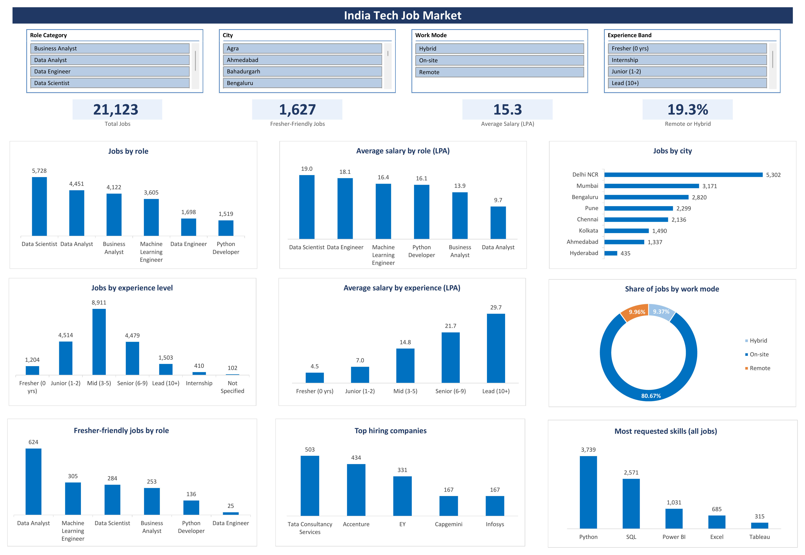

# Tech Jobs in India: A Market Analysis

> An interactive Excel dashboard that explores India's tech job market: which roles are in demand, where companies hire, what they pay, and where freshers can start.

---

## Project Overview

This project analyses India's technology job market to identify hiring patterns, salary trends, experience requirements, fresher opportunities, and in-demand technical skills.

The analysis covers six technology roles and provides insights into the opportunities available for both experienced professionals and fresh graduates.

---

## Dashboard Preview



---

## Dataset Information

| Attribute | Details |
|---|---|
| Dataset| India Tech Job Market 23K+ Records |
| Source| [Kaggle](https://www.kaggle.com/datasets/shree0910/india-tech-job-market-2026-23k-records) |
| Scrape Date | 10 June 2025 (as recorded in the file) |
| Original Dataset | 23,201 rows × 32 columns |
| Cleaned Dataset | 21,123 rows × 20 columns |

**Roles covered:** Data Scientist, Data Analyst, Business Analyst, Machine Learning Engineer, Data Engineer, Python Developer

---

## Business Questions

1. Which technology roles have the highest hiring demand, and which offer the highest salaries?
2. Which cities have the most job opportunities?
3. Which experience levels do job listings ask for most, and how does salary change with experience?
4. How many opportunities are available for freshers, and which roles offer the most openings?
5. How common are remote, hybrid, and on-site opportunities?
6. Which companies hire the most, and which technical skills are most requested?

---

## Tech Stack

| Tool | Purpose |
|---|---|
| Python (Pandas) | Data cleaning and transformation |
| Microsoft Excel | Analysis and dashboard development |
| PivotTables | Data summarisation and analysis |
| Excel Slicers | Interactive filtering |
| Excel Charts | Data visualisation |
| Excel Formulas | Dynamically link KPI cards to PivotTables |

---

## Data Cleaning

The raw dataset (23,201 rows, 32 columns) had no empty cells, but several values were incorrect or inconsistent.

- Removed 2,078 repeated listings.
- Fixed about 1,160 experience ranges that were saved as 0-0.
- Removed salaries on 306 unpaid roles, and converted monthly and rupee salaries to LPA.
- Blanked 40 salaries under 1.2 LPA on regular jobs (likely unit errors).
- Standardised city names (for example Bangalore to Bengaluru; Delhi, Noida and Gurugram grouped as Delhi NCR).
- Kept missing values blank, with no made-up values.

**Validation:** Experience ranges, salary values, skill flags and PivotTable totals were checked for consistency.

---

## Key Findings

- Data Scientist leads with 5,728 jobs, followed by Data Analyst with 4,451.
- Data Scientists earn an average of 19.0 LPA, nearly twice the Data Analyst average of 9.7 LPA.
- Delhi NCR and Mumbai together account for approximately 40% of all job listings.
- Mid-level positions (3–5 years) are the largest group, at 42% of jobs.
- Average salary rises about 3 times, from 4.5 LPA for freshers to 14.8 LPA at 3–5 years of experience.
- 1,627 jobs are fresher-friendly, and Data Analyst offers the most (624).
- 80.7% of jobs are on-site, while 19.3% are remote or hybrid.
- TCS, Accenture and EY together account for 1,268 job listings.
- Of the five tools tracked, Python (3,739 jobs) and SQL (2,571 jobs) are the most requested.

---

## Skills Demonstrated

- Data Cleaning and Preparation
- Data Validation
- Data Analysis
- Excel PivotTables and Slicers
- Excel Formulas
- Dashboard Development
- Data Visualization
- Business Analysis and Insight Generation

---

## Repository Structure

```
Tech_Jobs_in_India_Market_Analysis
│
├── India_Tech_Job_Market_Analytics.xlsx
├── Dashboard.png
└── README.md
```

---

## Limitations

- Only 2,167 listings contain salary information (about 10% of the dataset), so salary analysis uses only these records.
- 491 listings do not specify technical skills. The skills chart covers five tools (Python, SQL, Power BI, Excel and Tableau).

---

